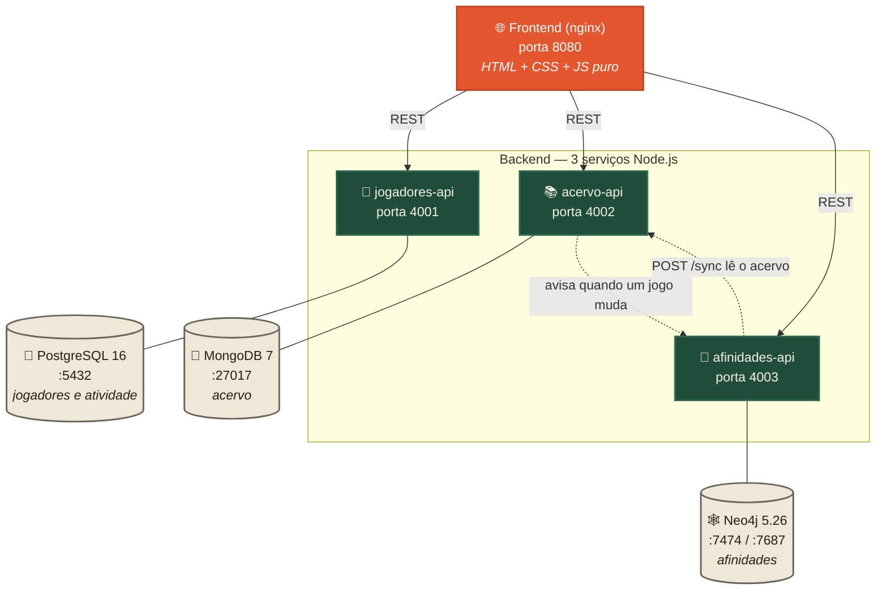

# 🎲 Ludoteca — Catálogo de Jogos de Tabuleiro

> Projeto da disciplina **Performance e Tuning de Dados**: Persistência Poliglota <br>
> Fundação Educacional Inaciana Padre Sabóia de Medeiros (FEI)


> [!IMPORTANT]
> **Para a apresentação, baixe a branch `main`.** É a versão estável e testada que deve ser mostrada ao professor.
> A branch `desenvolvimento` é onde o grupo faz alterações antes de juntar na `main`. Veja a seção [Branches](#-branches).

---

## 👥 Integrantes

| Nome | RA |
|------|----|
| Heron de Souza | 22.223.009-6 |
| João Mateus E. B. da Silva | 22.223.013-8 |
| Vinicius Trivellato | 22.223.022-9 |

---

## Sobre o projeto

A Ludoteca é um catálogo de jogos de tabuleiro. O jogador cria uma conta, navega pelo acervo, filtra por categoria ou
número de jogadores, favorita os jogos que quer jogar, vê o que está sendo mais acessado e recebe recomendações de
jogos parecidos com o que está olhando.

O objetivo do projeto é demonstrar **Persistência Poliglota**: em vez de colocar tudo num banco só, cada tipo de dado
vai para o banco cujo modelo combina com ele. Usamos **3 bancos**, cada um com um modelo de dados diferente:

| Dado | Característica | Banco | Modelo |
|------|----------------|-------|--------|
| Jogadores, favoritos, histórico e ranking de visualizações | estruturado, precisa de integridade (e-mail único, chaves estrangeiras) e de agregações (`COUNT`/`GROUP BY`) | **PostgreSQL** | relacional |
| Fichas dos jogos | cada jogo tem atributos diferentes (expansões, várias mecânicas, vários designers, faixa de jogadores...) | **MongoDB** | documentos |
| Afinidade entre jogos | "quais jogos compartilham mecânicas ou designers com este?" é uma travessia de relacionamentos | **Neo4j** | grafo |

---

## Arquitetura



Cada serviço é dono do seu banco (padrão *database per service*). Quando um jogo é criado, editado ou removido no
acervo, o `acervo-api` avisa o `afinidades-api`, que atualiza só aquele nó no grafo. Se o grafo estiver vazio ou
desatualizado, o `POST /sync` reconstrói tudo a partir do acervo.

---

## Por que cada banco?

### 🐘 PostgreSQL: jogadores e atividade

Conta de jogador tem campos fixos (nome, e-mail, senha, data de cadastro) e uma regra forte: **não pode haver dois
e-mails iguais**, o que é garantido por uma constraint `UNIQUE`. A atividade do jogador também é relacional:

- `favoritos`: chave primária composta `(jogador_id, jogo_id)`, que impede favoritar o mesmo jogo duas vezes.
  Tem `ON DELETE CASCADE`: se o jogador apaga a conta, os favoritos dele somem juntos.
- `visualizacoes`: cada vez que alguém abre um jogo vira uma linha. O **ranking** é um `COUNT(*) ... GROUP BY jogo_id` e
  o **histórico** é a mesma tabela filtrada pelo jogador. A FK usa `ON DELETE SET NULL`: se o jogador apagar a conta, a
  visualização fica anônima e continua contando no ranking.

As senhas são guardadas com hash **bcrypt** e o login devolve um **token JWT**, exigido nas rotas de favoritos e histórico.

### 🍃 MongoDB: acervo de jogos

Um jogo pode ter 2 mecânicas ou 5, um designer ou vários, várias expansões ou nenhuma, imagem ou não. Num banco relacional
isso viraria 4 ou 5 tabelas e vários JOINs só para montar uma ficha. No MongoDB cada jogo é **um documento** com tudo
dentro (inclusive a faixa de jogadores `{ min, max }` e a lista de expansões aninhada), e a ficha inteira sai numa leitura só.

```json
{
  "nome": "Catan",
  "categoria": "Família",
  "jogadores": { "min": 3, "max": 4 },
  "mecanicas": ["Rolagem de dados", "Negociação", "Construção de rotas"],
  "designers": ["Klaus Teuber"],
  "expansoes": [{ "nome": "Seafarers", "ano": 1997 }, { "nome": "Cities & Knights", "ano": 1998 }]
}
```

### 🕸️ Neo4j: afinidade entre jogos

Recomendar "jogos parecidos" é um problema de **relacionamentos**. Cada jogo, cada mecânica e cada designer vira um nó:

```
(:Jogo)-[:USA_MECANICA]->(:Mecanica)
(:Jogo)-[:CRIADO_POR]->(:Designer)
```

Para achar jogos parecidos, o banco percorre o grafo a partir do jogo atual: vai até as mecânicas e designers dele e volta
para os outros jogos ligados aos mesmos nós. A pontuação é **mecânicas em comum + 2 × designers em comum**:

```cypher
MATCH (origem:Jogo {id: $jogoId})-[:USA_MECANICA|CRIADO_POR]->(x)<-[:USA_MECANICA|CRIADO_POR]-(outro:Jogo)
WHERE outro <> origem
WITH outro, collect(DISTINCT x) AS comuns
WITH outro,
     [n IN comuns WHERE n:Mecanica | n.nome] AS mecanicas,
     [n IN comuns WHERE n:Designer | n.nome] AS designers
RETURN outro.nome, mecanicas, designers, size(mecanicas) + 2 * size(designers) AS pontuacao
ORDER BY pontuacao DESC LIMIT 5
```

No PostgreSQL isso exigiria uma tabela de junção para mecânicas, outra para designers e um self-join com contagem. No
Neo4j é uma travessia de dois saltos. O Neo4j também tem o **Neo4j Browser** (http://localhost:7474), que desenha o grafo
na tela, ótimo para mostrar na apresentação como os jogos se conectam.

---

## ⚡ Tuning aplicado

Como a disciplina é de performance, cada banco recebeu otimizações pensando nas consultas que o sistema realmente faz:

| Banco | Otimização | Por quê |
|-------|-----------|---------|
| PostgreSQL | índice `idx_visualizacoes_jogo (jogo_id)` | acelera o `GROUP BY jogo_id` do ranking |
| PostgreSQL | índice composto `idx_visualizacoes_jogador_data (jogador_id, visto_em DESC)` | o histórico filtra pelo jogador e ordena por data, e o índice já entrega nessa ordem |
| PostgreSQL | `UNIQUE (email)` + PK composta em `favoritos` | a regra de negócio fica garantida pelo banco, sem `SELECT` antes do `INSERT` (`ON CONFLICT DO NOTHING`) |
| PostgreSQL | `/estatisticas` com 3 subselects numa única query | uma ida ao banco em vez de três |
| MongoDB | índice de texto `busca_textual` com pesos (nome 10, mecânicas 5, designers 5, tags 3, descrição 1) e idioma português | busca relevante com stemming, ordenada por `textScore` |
| MongoDB | índice composto `{ categoria: 1, criadoEm: -1 }` | o filtro por categoria já sai ordenado do índice |
| MongoDB | índice `{ 'jogadores.min': 1, 'jogadores.max': 1 }` | filtro "jogos para N pessoas" |
| MongoDB | `GET /jogos?ids=a,b,c` (busca em lote com `$in`) | ranking, favoritos e histórico buscam todos os jogos numa chamada só (evita o problema N+1) |
| MongoDB | `.lean()` nas leituras | devolve objetos JS puros, sem o custo de montar documentos Mongoose |
| Neo4j | constraints de unicidade em `Jogo.id`, `Mecanica.nome`, `Designer.nome` | criam índices automaticamente, então o `MERGE`/`MATCH` por chave fica rápido e sem duplicatas |
| Neo4j | sincronização em lote com `UNWIND` | uma transação com poucas queries em vez de uma query por jogo e por mecânica |
| Neo4j | atualização incremental (`PUT /grafo/jogos/:id`) | editar um jogo atualiza só aquele nó, sem reconstruir o grafo inteiro |

---

## Estrutura de pastas

```
ludoteca-performance-e-tuning-de-dados/
├── docker-compose.yml
├── README.md
├── servicos/
│   ├── servico-jogadores/      → Node.js + PostgreSQL (contas, favoritos, histórico, ranking)
│   │   ├── Dockerfile
│   │   ├── package.json
│   │   └── index.js
│   ├── servico-acervo/         → Node.js + MongoDB (fichas dos jogos)
│   │   ├── Dockerfile
│   │   ├── package.json
│   │   ├── modelo.js           → schema do jogo + índices
│   │   ├── index.js
│   │   └── seed.js             → popula o acervo com 15 jogos e manda o grafo sincronizar
│   └── servico-afinidades/     → Node.js + Neo4j (grafo de mecânicas e designers)
│       ├── Dockerfile
│       ├── package.json
│       └── index.js
└── frontend/
    ├── Dockerfile
    └── public/
        ├── index.html          → aplicação principal (catálogo)
        ├── config.js           → endereços das APIs
        ├── estilo.css
        ├── ludoteca.js
        ├── monitor.html        → Monitor dos Bancos (os 3 bancos ao vivo)
        ├── monitor.css
        ├── monitor.js
        ├── explorador.css      → seção "Explorar os dados" do Monitor
        └── explorador.js       → tabela (PostgreSQL), JSON (MongoDB) e grafo desenhado (Neo4j)
```

---

## 🚀 Como executar (em qualquer computador)

O sistema roda inteiro em containers, então **o único pré-requisito é o Docker**. Não precisa instalar Node,
PostgreSQL, MongoDB nem Neo4j na máquina.

### 1. Instalar o Docker Desktop

- Baixe em **https://www.docker.com/products/docker-desktop** (Windows, macOS ou Linux).
- No Windows, deixe marcada a opção **"Use WSL 2"** durante a instalação. Se o instalador pedir, reinicie o computador.
- Abra o Docker Desktop e espere aparecer **"Engine running"** (ícone verde).
- Confira no terminal (PowerShell, Prompt ou Terminal do macOS/Linux):

```bash
docker --version
docker compose version
```

> Precisa de uns **4 GB de RAM livres** para os 3 bancos + 3 APIs. O Neo4j já está limitado a 512 MB de heap no compose.

### 2. Baixar o projeto (branch `main`)

Com git:

```bash
git clone -b main https://github.com/Herondsx/ludoteca-performance-e-tuning-de-dados.git
cd ludoteca-performance-e-tuning-de-dados
```

Sem git: no GitHub, escolha a branch **`main`** no seletor de branches, clique em **Code → Download ZIP**, extraia e
abra um terminal **dentro da pasta extraída** (onde está o `docker-compose.yml`).

### 3. Subir tudo

```bash
docker compose up --build
```

Na primeira vez demora alguns minutos (baixa as imagens do PostgreSQL, MongoDB, Neo4j, Node e nginx). Está pronto quando
aparecerem no log as linhas dos três serviços dizendo que estão ouvindo nas portas 4001, 4002 e 4003.

> **Neo4j é o mais lento para subir** (~30 a 60 segundos). O `afinidades-api` espera por ele sozinho; se ele reiniciar
> uma ou duas vezes no começo, é normal.

### 4. Popular o acervo com os 15 jogos de exemplo

Em **outro terminal**, na mesma pasta, com os containers rodando:

```bash
docker compose exec acervo-api npm run seed
```

Isso insere 15 jogos (Catan, Ticket to Ride, Carcassonne, Pandemic, Azul, 7 Wonders, Hanabi, Takenoko, Dominion,
Agricola, Patchwork, Splendor, Wingspan, Codenames e Dixit) no MongoDB e, logo em seguida, manda o `afinidades-api`
**montar o grafo no Neo4j**. As recomendações já ficam prontas.

### 5. Abrir no navegador

| O que é | Endereço |
|---------|----------|
| **Ludoteca (aplicação)** | http://localhost:8080 |
| **Monitor dos Bancos** (os 3 bancos ao vivo) | http://localhost:8080/monitor.html |
| API de Jogadores (PostgreSQL) | http://localhost:4001/saude |
| API do Acervo (MongoDB) | http://localhost:4002/saude |
| API de Afinidades (Neo4j) | http://localhost:4003/saude |
| **Adminer** (tabelas do PostgreSQL) | http://localhost:8082 (veja o login na seção abaixo) |
| **Mongo Express** (documentos JSON do MongoDB) | http://localhost:8081 (abre direto, sem login) |
| **Neo4j Browser** (desenha o grafo) | http://localhost:7474 (login `neo4j` / senha `ludoteca123`) |

### Parar e limpar

```bash
docker compose down        # para tudo e mantém os dados nos volumes
docker compose down -v     # para tudo e APAGA os dados (volta do zero; depois rode o seed de novo)
```

---

## 🎤 Roteiro sugerido para a apresentação

1. **Subir o ambiente** (`docker compose up --build`) e rodar o **seed** (passos 3 e 4) antes de começar.
2. **Aplicação** em http://localhost:8080:
   - Criar uma conta: grava no **PostgreSQL** (senha com bcrypt, e-mail único).
   - Navegar e filtrar jogos (busca, categoria, nº de jogadores): consultas no **MongoDB** usando os índices.
   - Abrir um jogo (ex.: **7 Wonders**): registra uma visualização no PostgreSQL e mostra **"Jogos parecidos"** vindos do
     **Neo4j**. Hanabi e Takenoko aparecem porque têm o mesmo designer (Antoine Bauza); Splendor e Wingspan aparecem
     pelas mecânicas em comum.
   - Favoritar, ver o Histórico e voltar ao Início para ver o ranking **"Jogos mais vistos"**.
3. **Monitor dos Bancos** em http://localhost:8080/monitor.html: clicar nos 4 botões e mostrar os números de cada banco
   mudando em tempo real (atualiza a cada 3 s). Depois, descer até **"🔎 Explorar os dados"** e passar pelas 3 abas:
   a tabela `jogadores` no PostgreSQL, o documento JSON do 7 Wonders no MongoDB e o grafo desenhado no Neo4j
   (clique no Hanabi para recentralizar).
   Se quiser mostrar as ferramentas "oficiais", abra o **Adminer** (http://localhost:8082) e o **Mongo Express**
   (http://localhost:8081). Veja a seção [Vendo os bancos de forma visual](#-vendo-os-bancos-de-forma-visual).
4. **Neo4j Browser** em http://localhost:7474 (`neo4j` / `ludoteca123`):

   ```cypher
   // grafo inteiro
   MATCH (j:Jogo)-[r]->(x) RETURN j, r, x

   // os três jogos do mesmo designer
   MATCH (d:Designer {nome: 'Antoine Bauza'})<-[:CRIADO_POR]-(j:Jogo) RETURN d, j

   // mecânicas que mais conectam jogos
   MATCH (m:Mecanica)<-[:USA_MECANICA]-(j:Jogo) RETURN m.nome, count(j) AS jogos ORDER BY jogos DESC
   ```

5. **Tuning na prática** (opcional, mostra os índices funcionando):

   **PostgreSQL**: abra o console do banco (funciona no PowerShell, CMD ou bash):

   ```bash
   docker compose exec postgres psql -U ludoteca -d ludoteca
   ```

   e, dentro dele, rode:

   ```sql
   \d visualizacoes
   EXPLAIN ANALYZE SELECT jogo_id, COUNT(*) FROM visualizacoes GROUP BY jogo_id ORDER BY 2 DESC LIMIT 10;
   EXPLAIN ANALYZE SELECT jogo_id, MAX(visto_em) FROM visualizacoes WHERE jogador_id = 1 GROUP BY jogo_id;
   \q
   ```

   **MongoDB**: abra o console do banco:

   ```bash
   docker compose exec mongodb mongosh ludoteca
   ```

   e, dentro dele, rode:

   ```js
   db.jogos.getIndexes()
   db.jogos.find({ $text: { $search: 'cooperativo' } }).explain('executionStats').executionStats
   db.jogos.find({ categoria: 'Família' }).sort({ criadoEm: -1 }).explain('executionStats').queryPlanner.winningPlan
   exit
   ```

   > Rode esses comandos no console interativo, não com `--eval`: no PowerShell, o `$text` dentro de aspas duplas
   > vira uma variável e a consulta quebra.

   > Com poucas linhas o PostgreSQL pode preferir *Seq Scan* mesmo tendo índice, porque ler a tabela inteira sai mais
   > barato que usar o índice. Isso também é decisão do otimizador, e vale comentar na apresentação.

---

## 🛰️ Monitor dos Bancos

Página de demonstração em http://localhost:8080/monitor.html (ou pelo botão **🛰️ Monitor** no menu da aplicação):

- **3 cartões**, um por banco (PostgreSQL, MongoDB, Neo4j), com bolinha de status online/offline;
- números ao vivo com **atualização automática a cada 3 segundos** e um destaque animado quando algum valor muda;
- **4 botões de ação** que disparam operações reais:
  - *Cadastrar jogador de teste* → `POST :4001/cadastro` → PostgreSQL
  - *Cadastrar jogo de teste* → `POST :4002/jogos` → MongoDB (e o grafo é atualizado sozinho)
  - *Simular visualização* → `POST :4001/visualizacoes` → PostgreSQL (ranking)
  - *Reconstruir grafo* → `POST :4003/sync` → Neo4j
- **console de log** mostrando qual API foi chamada e o resultado;
- seção **🔎 Explorar os dados**, com uma aba por banco, mostrando o dado no formato em que cada banco guarda:
  - **PostgreSQL**: tabela com linhas e colunas (`jogadores`, ranking de `visualizacoes`, totais) e o SQL equivalente;
  - **MongoDB**: lista dos documentos da coleção `jogos` e o **JSON completo** do documento escolhido, colorido;
  - **Neo4j**: a vizinhança de um jogo **desenhada como grafo** (mecânicas, designers e jogos parecidos), com o Cypher
    equivalente para colar no Neo4j Browser.

---

## 👀 Vendo os bancos de forma visual

Além do Monitor, cada banco tem uma interface web própria, que sobe junto no `docker compose up`:

| Banco | Ferramenta | Endereço | Como entrar |
|-------|-----------|----------|-------------|
| PostgreSQL | **Adminer** | http://localhost:8082 | Sistema **PostgreSQL**, servidor `postgres`, usuário `ludoteca`, senha `ludoteca123`, base `ludoteca` |
| MongoDB | **Mongo Express** | http://localhost:8081 | abre direto; clique em `ludoteca` → `jogos` |
| Neo4j | **Neo4j Browser** | http://localhost:7474 | usuário `neo4j`, senha `ludoteca123` |

- **Adminer**: clique numa tabela (`jogadores`, `favoritos`, `visualizacoes`) e em **"Selecionar dados"** para ver as
  linhas; em **"Comando SQL"** dá para rodar as consultas da seção de tuning, inclusive o `EXPLAIN ANALYZE`.
  O botão **"Abrir no Adminer"** do Monitor já abre com PostgreSQL, servidor, usuário e base preenchidos: só falta digitar a senha.
- **Mongo Express**: mostra cada documento da coleção `jogos` em JSON, com as listas e as expansões aninhadas, e
  também os **índices** da coleção (`busca_textual`, `categoria_1_criadoEm_-1`...).
- **Neo4j Browser**: rode `MATCH (j:Jogo)-[r]->(x) RETURN j, r, x` e arraste os nós para explorar o grafo.

> As três interfaces são só para demonstração local: o Mongo Express, por exemplo, não pede senha.

---

## Endpoints

### 👤 jogadores-api — PostgreSQL (porta 4001)

| Método | Rota | Login | O que faz |
|--------|------|:-----:|-----------|
| POST | `/cadastro` | | Cria conta `{nome, email, senha}` e devolve `{jogador, token}` |
| POST | `/login` | | Autentica `{email, senha}` e devolve `{jogador, token}` |
| GET | `/jogadores` | | Lista jogadores (sem senha) |
| GET | `/jogadores/:id` | | Busca um jogador |
| PUT | `/jogadores/:id` | ✔ (o próprio) | Atualiza nome e/ou e-mail |
| DELETE | `/jogadores/:id` | ✔ (o próprio) | Apaga a conta (favoritos vão junto em cascata) |
| POST | `/visualizacoes` | opcional | Registra que um jogo foi aberto `{jogoId}` |
| GET | `/ranking?limite=10` | | Jogos mais vistos `[{jogoId, visualizacoes}]` |
| GET | `/favoritos` | ✔ | Favoritos do jogador logado |
| POST | `/favoritos/:jogoId` | ✔ | Favorita um jogo |
| DELETE | `/favoritos/:jogoId` | ✔ | Remove dos favoritos |
| GET | `/historico` | ✔ | Últimos 20 jogos vistos pelo jogador |
| GET | `/estatisticas` | | Totais de jogadores, visualizações e favoritos |
| GET | `/saude` | | Verifica a conexão com o PostgreSQL |

Rotas com login esperam o cabeçalho `Authorization: Bearer <token>`.

### 📚 acervo-api — MongoDB (porta 4002)

| Método | Rota | O que faz |
|--------|------|-----------|
| GET | `/jogos` | Lista jogos. Filtros: `?q=` (busca textual), `?categoria=`, `?jogadores=N`, `?limite=`, `?ids=a,b,c` (busca em lote) |
| GET | `/jogos/:id` | Ficha completa de um jogo |
| POST | `/jogos` | Cadastra jogo (e avisa o grafo) |
| PUT | `/jogos/:id` | Atualiza jogo (e avisa o grafo) |
| DELETE | `/jogos/:id` | Remove jogo (e avisa o grafo) |
| GET | `/estatisticas` | Total de jogos e contagem por categoria (aggregation pipeline) |
| GET | `/saude` | Verifica a conexão com o MongoDB |

### 🔗 afinidades-api — Neo4j (porta 4003)

| Método | Rota | O que faz | CRUD |
|--------|------|-----------|------|
| POST | `/mecanicas/:jogoId/:mecanica` | Liga uma mecânica a um jogo (cria o nó se não existir) | **Create** |
| GET | `/jogos/:jogoId/mecanicas` | Lista as mecânicas de um jogo no grafo | **Read** |
| PUT | `/mecanicas/:antiga/:nova` | Renomeia uma mecânica em todos os jogos de uma vez | **Update** |
| DELETE | `/mecanicas/:jogoId/:mecanica` | Remove a ligação (e o nó, se ficar órfão) | **Delete** |
| GET | `/similares/:jogoId` | Top 5 jogos mais parecidos (mecânicas + designers em comum) | consulta de grafo |
| GET | `/mecanicas/populares?limite=10` | Mecânicas ligadas a mais jogos | agregação |
| GET | `/grafo/resumo` | Quantidade de nós e relações | agregação |
| PUT | `/grafo/jogos/:id` | Insere/atualiza um jogo no grafo (chamado pelo acervo) | upsert |
| DELETE | `/grafo/jogos/:id` | Remove um jogo do grafo (chamado pelo acervo) | delete |
| POST | `/sync` | Reconstrói o grafo inteiro a partir do acervo (em lote, com `UNWIND`) | carga em lote |
| GET | `/saude` | Verifica a conexão com o Neo4j | |

#### Demonstrando o CRUD do grafo ao vivo

Pegue o id de um jogo (ex.: abra o jogo na aplicação e copie o final da URL, ou acesse http://localhost:4002/jogos) e,
com o Neo4j Browser aberto, rode um comando por vez e execute a query do grafo de novo depois de cada um:

```bash
# Create: liga a mecânica "blefe" ao jogo
curl -X POST http://localhost:4003/mecanicas/<ID_DO_JOGO>/blefe

# Read: mecânicas do jogo
curl http://localhost:4003/jogos/<ID_DO_JOGO>/mecanicas

# Update: renomeia "draft" para "seleção aberta" em TODOS os jogos de uma vez
curl -X PUT "http://localhost:4003/mecanicas/draft/sele%C3%A7%C3%A3o%20aberta"

# Delete: desfaz a ligação criada acima (o nó "blefe" some por ficar órfão)
curl -X DELETE http://localhost:4003/mecanicas/<ID_DO_JOGO>/blefe

# Reconstrói o grafo do zero a partir do MongoDB
curl -X POST http://localhost:4003/sync
```

> No **Windows PowerShell**, use `curl.exe` no lugar de `curl` (ou `Invoke-RestMethod -Method Post <url>`).

---

## 🧯 Problemas comuns

| Sintoma | Solução |
|---------|---------|
| `port is already allocated` ao subir | Alguma porta (8080, 8081, 8082, 4001–4003, 5432, 27017, 7474, 7687) já está em uso na máquina. Feche o programa que usa a porta ou troque o lado esquerdo do mapeamento no `docker-compose.yml` (ex.: `"8090:80"`). |
| "Jogos parecidos" não aparece | O grafo está vazio. Rode `docker compose exec acervo-api npm run seed` ou clique em *Reconstruir grafo* no Monitor. |
| `afinidades-api` reiniciando no começo | O Neo4j ainda está subindo. Espere ~1 minuto. |
| Cartão do Monitor vermelho (offline) | O serviço daquele banco caiu. Veja o log com `docker compose logs <servico>` (ex.: `docker compose logs afinidades-api`). |
| Quero começar do zero | `docker compose down -v`, depois `docker compose up --build` e o seed de novo. |

---

## 🌿 Branches

| Branch | Para quê |
|--------|----------|
| **`main`** | **Versão de apresentação.** Estável, testada, é a que deve ser baixada e mostrada ao professor. |
| `desenvolvimento` | Onde o grupo trabalha. Alterações são feitas aqui e, depois de testadas, juntadas na `main`. |

Fluxo para alterar alguma coisa:

```bash
git checkout desenvolvimento
# ...faz as alterações e testa com docker compose up --build...
git add .
git commit -m "descrição da alteração"
git push origin desenvolvimento

# quando estiver tudo certo, leva para a main
git checkout main
git merge desenvolvimento
git push origin main
```
